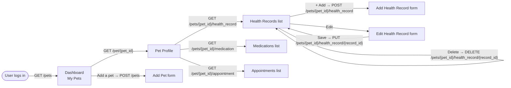
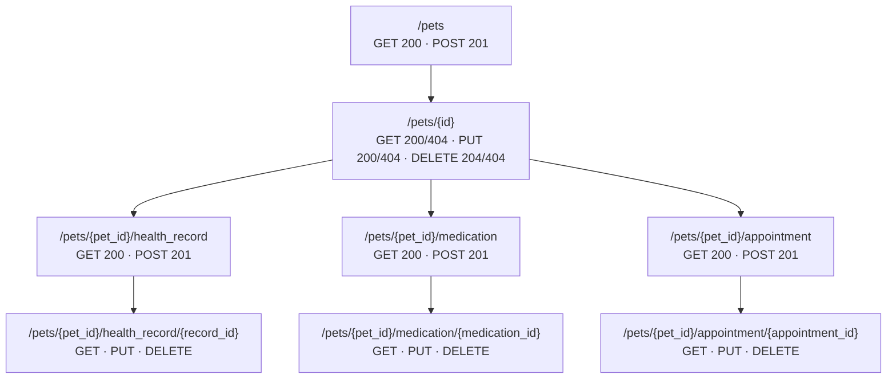
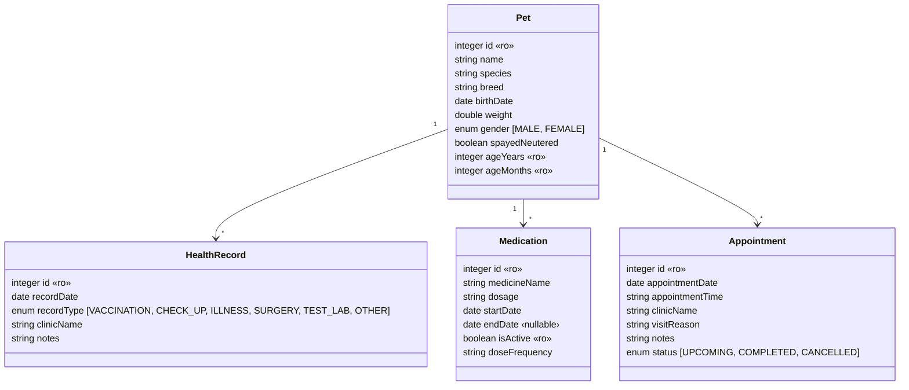

# Pet Health Tracker — API Design Overview

The source of truth for the API is `pet-health-api_V1.0.1.yaml` (OpenAPI 3.0.3), which is already YAML.
This file turns the **wireframe → endpoint PNGs** into Mermaid and summarises the YAML so you can compare them.

## 1. UI flow → endpoints (from the REST API PNGs, as drawn)

Paths and payloads are copied exactly as they appear in the images, typos included. They're compared against the YAML in the consistency report.



### Request bodies shown in the PNGs

```yaml
# POST /pets   (REST API_add a pet.png)
name: Maru
species: Dog
breed: Maltipoo
"birth date": { year: 2022, month: 11, day: 12 }
weight: 10

# POST /pets/{pet_id}/health_record   (REST API_add health record.png)
"record date": { year: 2026, month: 8, day: 15 }
"record type": Check-up
"clinic name": A Niu
Notes: Lorem ipsum dolor sit amet

# PUT /pets/{pet_id}/health_record/{record_id}   (REST API_edit-delete health record.png)
"record date": { year: 2025, month: 9, day: 28 }
"record type": Other
"clinic name": Burquitlam Animal Hospital
Notes: Lorem ipsum dolor sit amet
```

### Status codes (CRUD endpoints status code.png)

| Situation | Code |
|---|---|
| GET succeeds | 200 |
| POST succeeds | 201 |
| PUT succeeds | 200 |
| DELETE succeeds | 204 |
| Bad / invalid data | 400 |
| GET/PUT/DELETE on a missing ID | 404 |

## 2. Endpoint map (from pet-health-api_V1.0.1.yaml)



## 3. Schemas (from pet-health-api_V1.0.1.yaml)

`«ro»` = `readOnly: true` (computed or generated on the server).


