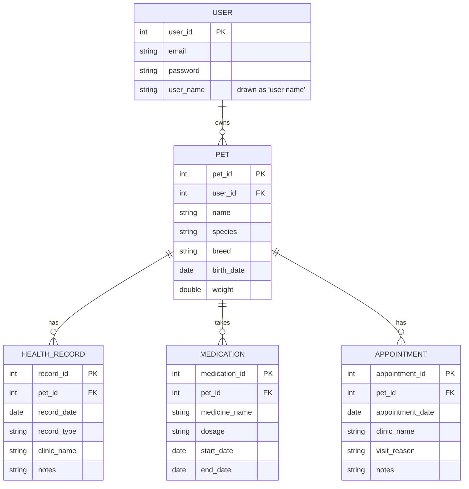

# Pet Health Tracker — Database Design (ERD)

Converted from `designs/db-design/Pet Health - ERD.png`. Entities, keys, attributes and relationships are as drawn.
The original diagram has no data types, so the types below are **inferred** (Mermaid requires one per attribute).

Relationship notes: the PNG uses crow's-foot "one-or-many" (`|<`) on the child side. That's rendered here as zero-or-many (`o{`), because a new user has no pets yet and a new pet has no records. If you really mean "at least one", change `o{` to `|{`.
