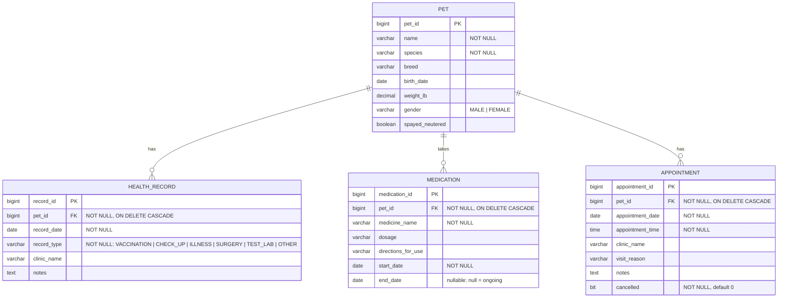

# Pet Health Tracker — Database Design (ERD)

Matches `designs/api-design/pet-health-api.yaml`. Database columns use `snake_case` and API fields use `camelCase` (JPA maps one to the other).

**Single-user MVP:** there is no `USER` table. The app has one user, so pets aren't linked to an owner. Multi-user support (a `USER` table plus `pet.user_id`) is a future feature.

## Notes

- **Column names that don't follow the camelCase → snake_case rule** need an explicit `@Column(name = ...)`: API `id` → `pet_id` / `record_id` / `medication_id` / `appointment_id`, and API `weight` → `weight_lb`.
- **Enums** (`gender`, `record_type`) are stored as strings with the same values as the API. Add a `CHECK` constraint for each; with JPA, use `@Enumerated(EnumType.STRING)`.
- **Deleting a pet** deletes its health records, medications and appointments (`ON DELETE CASCADE`, or JPA `cascade = CascadeType.REMOVE, orphanRemoval = true`).
- **Relationships** are zero-or-many (`o{`): a new pet has no records yet.
