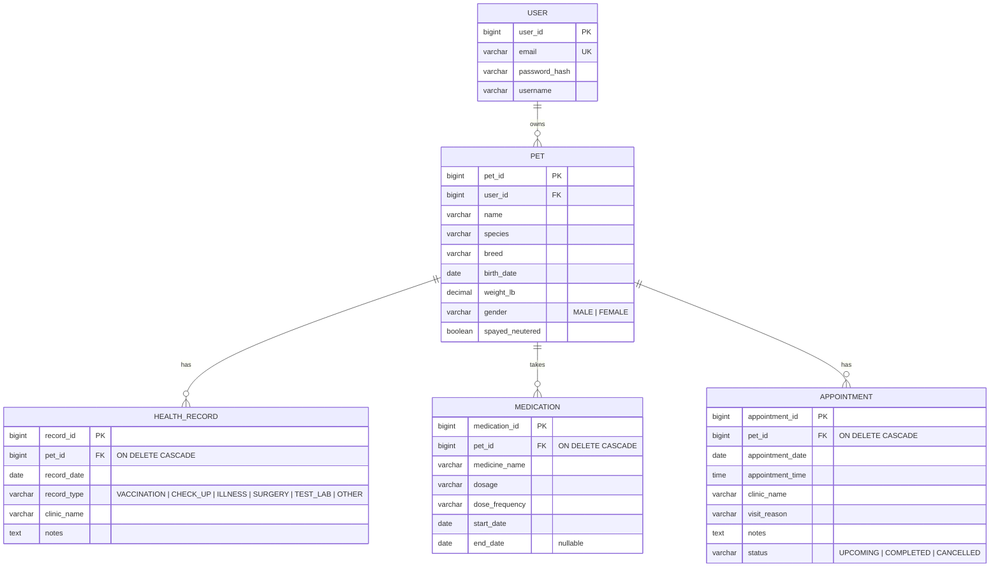

# Design Consistency Check — API vs DB vs Wireframes

Compared:

- **ERD**: `db-design/Pet Health - ERD.png` (Mermaid version: `pet-health-erd.md`)
- **OpenAPI**: `api-design/pet-health-api_V1.0.1.yaml` (treated as current; v1.0.0 is covered at the end)
- **API PNGs**: the wireframe-to-endpoint images in `api-design/` (Mermaid version: `pet-health-api-overview.md`)

Severity: 🔴 will break or block implementation · 🟠 mismatch to resolve before coding · 🟡 convention or cleanup

---

## 1. ERD ↔ OpenAPI

### 1.1 Field-by-field

| Entity | Field | ERD | OpenAPI | Issue |
|---|---|---|---|---|
| User | *whole entity* | ✅ `user_id, email, password, user name` | ❌ no schema, no endpoints | 🔴 see 1.2 |
| Pet | `user_id` FK | ✅ | ❌ | 🔴 see 1.2 |
| Pet | `gender` | ❌ | ✅ enum MALE/FEMALE | 🟠 missing column |
| Pet | `spayedNeutered` | ❌ | ✅ boolean | 🟠 missing column |
| Pet | `ageYears`, `ageMonths` | ❌ | ✅ readOnly | ✅ OK if computed from `birth_date`. Don't store them |
| Pet | `weight` | no unit | `double`, no unit | 🟡 UI shows **lb**; write the unit down (column name or description) |
| Health_Record | all fields | ✅ | ✅ | ✅ matches |
| Medication | `doseFrequency` | ❌ | ✅ string | 🟠 missing column |
| Medication | `isActive` | ❌ | ✅ readOnly | ✅ OK if derived from `end_date` (null or in the future = active). Don't store it |
| Medication | `end_date` nullability | not specified | `nullable: true` | 🟡 mark it nullable in the DB |
| Appointment | `appointmentTime` | ❌ | ✅ string | 🟠 missing column (or merge into one `appointment_datetime`) |
| Appointment | `status` | ❌ | ✅ enum UPCOMING/COMPLETED/CANCELLED | 🟠 missing column |

### 1.2 🔴 Users and ownership exist in the DB but not in the API

The ERD says every pet belongs to a user, and the PNGs start with "once user has logged in". The API has:

- no `User` schema, and no register, login or "current user" endpoints
- no `userId` on `Pet`, and no auth (`securitySchemes`)
- `GET /pets` returning **all** pets rather than the logged-in user's pets

**Decide one of these:** (a) MVP is single-user: drop `User` from the ERD for now and note it as a future feature, or (b) add auth (`/auth/register`, `/auth/login`, a bearer `securitySchemes`), scope `/pets` to the authenticated user, and have the server set `user_id` (never the client).

### 1.3 Enums and types not captured in the ERD
`record_type`, `gender` and `status` are enums in the API but plain attributes in the ERD, and the ERD has no data types at all. Add types and either a `CHECK` constraint or a lookup table for each enum. With Spring/JPA, `@Enumerated(EnumType.STRING)` matches the YAML values directly.

### 1.4 Delete behaviour undefined
`DELETE /pets/{id}` exists, but neither design says what happens to that pet's health records, medications and appointments. The usual choice is `ON DELETE CASCADE` (or JPA `cascade = REMOVE, orphanRemoval = true`). Write it into the ERD.

### 1.5 🟡 Naming
The ERD uses `snake_case`, the API uses `camelCase`. That's fine and normal (JPA maps it), but the ERD has `user name` with a space. Make it `username` or `user_name`.

---

## 2. API PNGs ↔ OpenAPI

| # | PNG says | OpenAPI says | Sev | Fix |
|---|---|---|---|---|
| 2.1 | `GET /pet/{pet_id}` (view pet profile) | `/pets/{id}` | 🔴 | Use plural `/pets` everywhere |
| 2.2 | `GET /pet/{pet_id}/appointment` (view records/med/appt) | `/pets/{pet_id}/appointment` | 🔴 | Same |
| 2.3 | `"birth date": {year, month, day}` | `birthDate: "2022-11-12"` (format: date) | 🔴 | Use the ISO string from the YAML. Jackson parses it straight into `LocalDate` |
| 2.4 | `"record date": {year, month, day}` | `recordDate: "2025-07-15"` | 🔴 | Same |
| 2.5 | Keys with spaces and mixed case: `"record type"`, `"clinic name"`, `"Notes"` | `recordType`, `clinicName`, `notes` | 🔴 | camelCase as in the YAML |
| 2.6 | `"record type": "Check-up"` | enum `CHECK_UP` | 🔴 | Send `CHECK_UP`. The UI maps it to the label "Check-up" |
| 2.7 | Add Pet form: name, species, breed, birth date, weight | Pet also has `gender`, `spayedNeutered` | 🟠 | Add both to the form, or leave them out of the API for now |
| 2.8 | Status table lists **400 Bad Request** | No endpoint declares 400, and no schema has `required` fields | 🟠 | Add `required:` lists to the schemas and `'400'` to every POST/PUT |
| 2.9 | 404 for "an ID that doesn't exist" | Nested `GET` list and `POST` (e.g. `/pets/{pet_id}/medication`) don't declare 404 when `pet_id` doesn't exist | 🟠 | Add `'404'` to those operations |
| 2.10 | Pet profile shows medication **"Next dose: Aug 20"** | `doseFrequency` is free text (`"Every 30 days"`) and there's no last-dose field, so the server can't compute a next dose | 🟠 | Store frequency as a number (`doseIntervalDays`) plus `lastDoseDate`, add a readOnly `nextDoseDate`, or drop "Next dose" from the UI |
| 2.11 | — | Medication and appointment add/edit/delete have endpoints but no wireframe PNGs | 🟡 | Coverage gap, not a conflict |
| 2.12 | The JSON in the PNGs has mismatched quotes (e.g. `"record type": Check-up"`, `"Notes: "…"`) | — | 🟡 | Cosmetic. Fix if the images go in a portfolio |

---

## 3. Inside the OpenAPI file itself

| # | Issue | Sev | Fix |
|---|---|---|---|
| 3.1 | Path param is `{id}` on `/pets/{id}` but `{pet_id}` on the nested paths | 🟡 | Use one name everywhere (`{petId}` is the common OpenAPI style) |
| 3.2 | Sub-resources are singular and snake_case (`/health_record`, `/medication`, `/appointment`) while the root is plural (`/pets`) | 🟡 | REST convention: `/pets/{petId}/health-records`, `/medications`, `/appointments`. If you change it, update the PNGs too |
| 3.3 | `appointmentTime` is a plain string with no format or pattern | 🟡 | Add `pattern: '^([01]\d\|2[0-3]):[0-5]\d$'`, or combine into one `appointmentDateTime` (`format: date-time`) |
| 3.4 | One schema is used for both request and response | ✅ | Works, because `readOnly` excludes `id`, age and `isActive` from requests |

---

## 4. v1.0.0 vs v1.0.1

| | v1.0.0 | v1.0.1 |
|---|---|---|
| Server port | `localhost:8000` | `localhost:8080` (Spring Boot default) |
| `POST /pets` | 🔴 **no requestBody** | fixed |
| Scope | pets only | pets, health records, medications, appointments |
| Filename | `v1.0.0` | `V1.0.1` (capital V) 🟡 |

v1.0.1 supersedes v1.0.0. Consider deleting v1.0.0 (git history keeps it) and using lowercase `v` in the filename.

---

## 5. Suggested reconciled ERD

This assumes option (b) in 1.2 (keep users) and the API's current fields. Derived fields (`age*`, `isActive`) are intentionally **not** stored.

## Top 5 to fix first

1. Decide on users and auth (1.2). It changes the ERD, the API and every query.
2. Align the PNG payloads with the YAML: ISO dates, camelCase keys, enum values (2.3–2.6).
3. Use `/pets` everywhere, never `/pet` (2.1–2.2).
4. Add the missing ERD columns: gender, spayed_neutered, dose_frequency, appointment_time, status (1.1).
5. Add `required` fields and 400/404 responses to the YAML (2.8–2.9).
